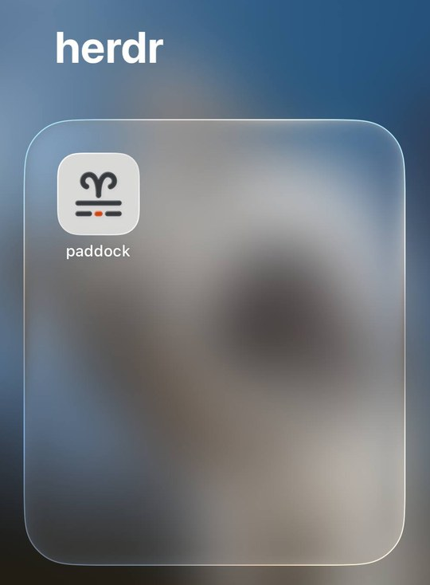

# Running locally, and reaching it from your phone

paddock is **one process on the same machine as herdr**, bound to
`127.0.0.1:8787`. That is a design decision, not a limitation waiting to be
fixed:

- It reads herdr over a **unix domain socket**, which is a filesystem object
  with no network form. There is nothing to connect to remotely.
- It has **no authentication of its own**, deliberately — an app token would
  also gate `/sw.js` and silently disable the service worker and push. See
  [`decisions.md`](decisions.md).

> [!WARNING]
> **Do not port-forward `8787` or bind it to `0.0.0.0`.** paddock can send
> keystrokes and arbitrary text to your agents, answer their permission
> prompts, and read everything on their screens. Anyone who reaches the port
> can do all of that. There is no login to stop them.

## Reaching it from your phone

Put an authenticating tunnel in front of it — the tunnel terminates at your
machine, and the identity check happens before any request reaches paddock:

- **[Cloudflare Tunnel](https://developers.cloudflare.com/cloudflare-one/connections/connect-networks/)
  + [Zero Trust Access](https://developers.cloudflare.com/cloudflare-one/policies/access/)**
  — what this was designed against. `cloudflared` dials out, so no inbound port
  is opened, and an Access policy gates the hostname on your identity provider.
  Step by step in [`deploy-cloudflare.md`](deploy-cloudflare.md).
- **[Tailscale](https://tailscale.com/)** — `paddock tailscale` publishes the
  dashboard on your tailnet's HTTPS name, for you only. See
  [Tailscale](#tailscale) below.
- **An SSH tunnel** — fine for a laptop, awkward on a phone.

Whichever you choose, the requirement is the same: **something must
authenticate the request before paddock sees it.**

## Tailscale

```bash
paddock local        # paddock must be running as the user service
paddock tailscale    # publish it at https://dev-box.example-tailnet.ts.net
```

Needs the `tailscale` CLI (the macOS app's bundled one counts), this machine
signed in to a tailnet, and **HTTPS Certificates** enabled (admin console →
DNS). It refuses, with the fix, inside a container, when paddock is not
running as the service, when the node has no Tailscale user (use
`--login <name>`), and when HTTPS 443 already serves something else. It never
overwrites that.

What it does: records the allowed login (this machine's Tailscale user, or
`--login`) in `tailscale.json` in the config directory, restarts the service,
runs `tailscale serve --bg --https=443 http://127.0.0.1:8789`, checks that the
name reaches paddock, then prints the URL and a QR code. The first run on a
node can sit at "checking" for up to a minute (about 27s, measured) while
Tailscale issues the HTTPS certificate; it waits up to 90s. `PADDOCK_TAILNET_PORT`
changes the 8789. The service reads it, so set it in the environment before
`paddock local`, which captures it into the service, and use the same value
for `paddock tailscale`.

On Linux, `tailscale serve` needs root or tailscaled's operator user, and fails
with `Access denied` otherwise: run `sudo tailscale set --operator=$USER` once,
then `paddock tailscale` again.

On the phone: join the same tailnet, open the URL, Share → Add to Home Screen,
then enable push in Settings. The ts.net URL is its own origin, so on iOS it is
its own installed app with its own push subscription: an icon and a
subscription made for another URL do not carry over.

Trust: every device signed in as the allowed Tailscale user is treated like the
phone in your hand, **including answering permission prompts**. Only that user
gets in; anyone else, and anything not arriving through `tailscale serve`, is
refused. Funnel is never used.

```bash
paddock tailscale off   # remove paddock's serve config and the allowed login
paddock status          # shows the tailnet URL and who is allowed
```

`paddock stop` removes the serve config but keeps the login, and `paddock
local` puts it back. The Docker setup (`make up`) is not supported.

## Keeping it running

A paddock your phone can reach has to outlive the terminal you started it
from — and the machine's next reboot. Once a named tunnel is in front of it,
`paddock local` is the normal way to run it: it registers paddock as a user
service — a systemd user unit on Linux, a launchd agent on macOS — so it comes
back after a crash and after a reboot, and the tunnel finds it on the same
port.

```bash
paddock local     # register, start, wait until it answers
paddock status    # pid, port, uptime, and the service line
paddock stop      # stops it AND removes it from boot
```

On Linux it starts at **boot**, before anyone logs in, if linger is on;
`paddock local` turns linger on and tells you plainly when it could not (some
distros need `sudo loginctl enable-linger $USER`). On macOS a LaunchAgent can
only start at **login**, and `paddock local` says so.

The unit runs plain `paddock` in the foreground with a snapshot of `PATH`,
`HOME`, `HERDR_*` and `PADDOCK_*` taken when you ran `paddock local`. Change
one of those? Run `paddock local` again — it rewrites the unit and restarts
the service. Output goes to `journalctl --user -u paddock` (Linux) or
`~/.config/paddock/paddock-service.log` (macOS). It restarts on failure only: a
paddock that exits cleanly stays down.

After a reboot, herdr is usually not running until you start it. paddock
exits while it cannot reach herdr and the service manager restarts it every
ten seconds; your phone sees the tunnel's error page until herdr is up, then
everything connects on its own.

No named tunnel? `paddock start` publishes on a quick tunnel instead, in the
background — and if `paddock local` is already serving, it publishes that one.
Its output goes to `~/.config/paddock/paddock.log` (`PADDOCK_CONFIG_DIR` moves
it), truncated on every start.

Running paddock under a service manager of your own instead? Point it at plain
`paddock` (no verb) in the foreground: systemd's default `Type=simple` tracks
the process it launched directly, which is exactly what a foreground paddock
is. See decision 33 in `docs/decisions.md`.

## Then add it to your Home Screen

<p align="center">
  
</p>

Once it is reachable, **Share → Add to Home Screen** turns paddock into an app
— its own icon, no browser chrome, and it opens where you left off. The
manifest and icons that make that work already ship.

On iOS this is also the only way to get Web Push, if it ever lands — Safari
delivers notifications to an installed PWA and never to a page in a tab.

## herdr on another machine

Possible, and it needs no code change: forward the remote socket to a local
path.

```bash
# the second path is the REMOTE user's socket, absolute on that machine
ssh -N -L /tmp/remote-herdr.sock:/path/to/remote/.config/herdr/herdr.sock operator@lan-box
PADDOCK_HERDR_SOCKET=/tmp/remote-herdr.sock paddock
```

Verified through a relayed socket, event stream included. Note this gives you
**one** remote herdr per paddock, not several machines in one dashboard — that
is still [on the roadmap](roadmap.md).
