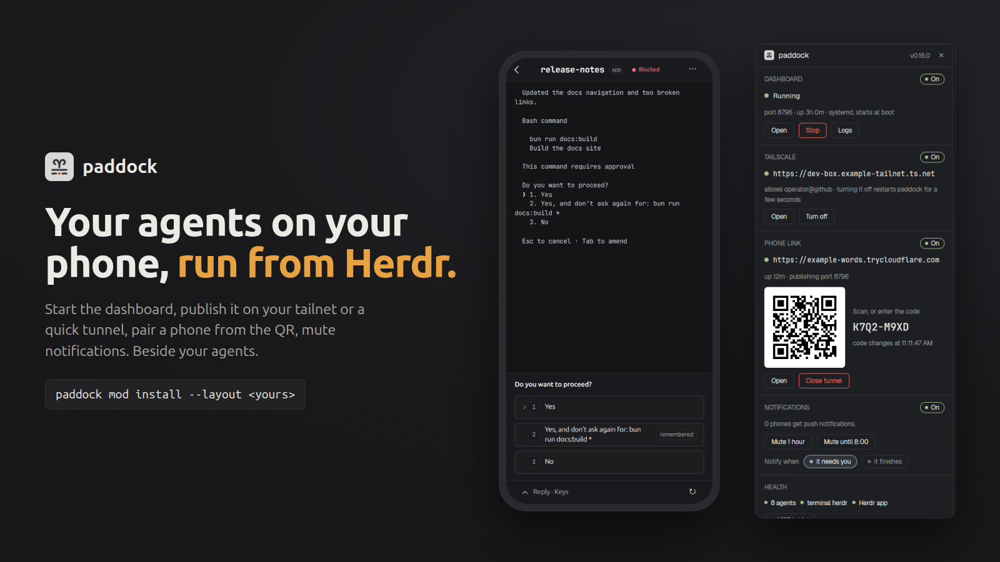

# paddock

A panel beside your agents for [paddock](https://github.com/lntvan166/paddock), the phone
dashboard for herdr: start and stop it, publish it on your tailnet or on a quick tunnel, pair a
phone from a QR code, mute notifications, and see that it is healthy, without leaving Herdr. A
button in the tab bar shows and hides it.



**Needs:** [paddock](https://github.com/lntvan166/paddock) 0.16 or later on this machine (the
panel offers to install it when it is missing). The Tailscale section also needs Tailscale,
signed in; the phone link needs `cloudflared`. Without them those sections say so and link to
the download; everything else works.

Install it with paddock itself, which also wires it into a layout of yours:

```sh
paddock mod install --layout <your-layout>
```

## What you see

A column on the right, 400px, hidden until its button is pressed. Its top is a 42px header: the
paddock mark (18px), "paddock" in the UI font one step up and semibold, the version in muted
text, and a close button. Below it, sections separated by 1px `border` lines, each titled in
small muted capitals:

- **Dashboard.** A dot and a word: green "Running" (the theme's `ansi2`), `blocked` "Running,
  not tracked" or "Unknown", `dim` "Stopped". A muted line says the port, uptime and how it
  runs (a systemd or launchd service that starts at boot, or a plain process). Buttons: Open
  (the dashboard in the browser), Run as a service (only for a plain process), Stop, Logs; or
  Start when it is stopped.
- **Tailscale.** Off: one sentence and Turn on. Up: a green dot, the https URL in the terminal
  font, who it allows, Open and Turn off. Broken: why, Repair and Turn off.
- **Phone link.** No tunnel: chips for 30 min, 2 hours and 7 days, and Open a tunnel. Open: the
  public URL, its uptime, a QR code (white tile, 4px modules, 4-module quiet zone) beside the
  pairing code in the terminal font, six points larger, with when it changes; Open and Close
  tunnel.
- **Notifications.** How many phones get pushes (and Telegram, when it is on), or "Muted until
  14:05". Mute 1 hour, Mute until 8:00 (or Unmute). Chips for "it needs you" and "it finishes".
- **Health.** Small dots: the number of agents, terminal herdr, the Herdr app. The last
  notification error, if any, in `blocked`. A chip for the MCP bridge, and Update to x.y.z when
  a newer paddock is out.

When paddock is missing, the panel is one section, "Not installed": the install command
(Homebrew on macOS, else the install script) and Install paddock, which runs it in a pane below
that waits for Enter; Check again reads it once more. A paddock without `status --json` shows
"Too old" and Update paddock (`paddock update` in a pane). When `status --json` reports
`tools.tailscale` or `tools.cloudflared` as null, that section's pill says "Needs Tailscale" or
"Needs cloudflared" and its buttons are Get Tailscale / Get cloudflared (Install with Homebrew on
macOS) and Check again.

A failed action leaves a banner at the bottom, in `blocked`, with the command's last lines and a
close button. The tab-bar button is 26px high: the mark, "paddock", and a 6px dot, green while
paddock runs.

## How it behaves

- Every button runs the `paddock` CLI (`local`, `stop`, `tailscale`, `tailscale off`,
  `start --for 2h`, `tunnel stop`, `update`) or writes the dashboard's own API on
  `127.0.0.1:<port>` (`POST /api/settings/mute`, `PUT /api/settings`). While one runs, the
  buttons give way to a spinning "Starting…" and nothing else can start.
- Stop asks twice: the first press turns it into "Stop: tunnel, Tailscale and service too",
  because `paddock stop` takes all of them down.
- Logs opens a pane below with `journalctl --user -u paddock -f` (or `tail -f` of the launchd
  log).
- The panel reads `paddock status --json` every 5 seconds while shown, every 30 while hidden,
  and right after every action. The tab-bar button's dot follows it through shared state
  `paddock.state`.

## Built from

- One mod, `mods/paddock/`, roles in `props.role`: the panel (default) and `"toggle"`.
- Layout: a block `{ "mod": "paddock", "props": { "role": "toggle" } }` (`paddock-toggle`,
  116px) beside the tab bar, in a row; a column `paddock-panel` (400px, `hidden: true`) holding
  a block `{ "mod": "paddock" }`, beside the `{ "tab": "active" }` block, in a row. The toggle
  runs `layout.toggle { id: "paddock-panel" }`; in a layout without that node it opens the panel
  with `mod.open { name: "paddock" }` (a dialog, from `mod.json`).
- `herdr`: `exec`, `fetch`, `run`, `theme`, `settings`, `layout`, `shared`/`setShared`,
  `readTextFile`, `appHome`, `notify`, `closeOverlay`, `props`, `window`.
- Programs: `paddock` (0.16 or later, for `status --json` and `tunnel stop`), `xdg-open` /
  `open` / `start` for Open. `config.json` beside the mod names the paddock binary to run;
  `paddock mod install` writes it.
- Art: `mark.svg` (paddock's mark), `close.svg`, `spinner.svg`.

## Watch out

- It runs programs (`paddock`, the browser opener, `journalctl`) and talks to the paddock
  dashboard on 127.0.0.1. It reads no files but its own `config.json`.
- Without `config.json` (a copy from the gallery) it runs `paddock` from PATH, then
  `~/.local/bin/paddock`; an older release has no `status --json`, and the panel says so.
- `paddock stop` also removes the service and closes the tunnel and Tailscale serve. That is
  why Stop asks twice.
- The QR is drawn as runs of `div`s per row, a few dozen elements, not one per module.

## Done when

- `herdr-app check mods/paddock` passes.
- With paddock running as a service, the panel says Running with its port and "systemd, starts
  at boot" (or launchd); Logs opens a pane following its log.
- Open a tunnel for 30 min: a URL, a QR and a code appear; a phone that scans the QR pairs.
  Close tunnel: the section goes back to the chips, and paddock is still running.
- Mute 1 hour: "Muted until …" appears, and the phone gets no pushes until Unmute.
- Turning Tailscale off and on changes the section within a few seconds, and the toggle's dot
  stays green throughout.
