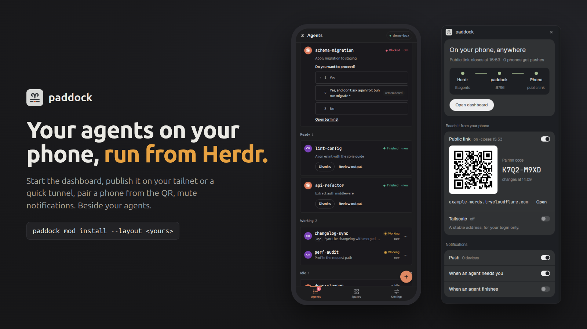

# paddock

A panel beside your agents for [paddock](https://github.com/lntvan166/paddock), the phone
dashboard for herdr: start and stop it, publish it on your tailnet or on a quick tunnel, pair a
phone from a QR code, mute notifications, and see that it is healthy, without leaving Herdr. A
button in the tab bar shows and hides it.



**Needs:** [paddock](https://github.com/lntvan166/paddock) 0.16 or later on this machine (the
panel offers to install it when it is missing). The Tailscale section also needs Tailscale,
signed in; the phone link needs `cloudflared`. Without them those sections say so and link to
the download; everything else works.

Install it with paddock itself, which also wires it into a layout of yours:

```sh
paddock mod install --layout <your-layout>
```

## What you see

A column on the right, 400px, hidden until its button is pressed, in the "true-black flat" app
style on Herdr's own theme tokens: elevation by lightness alone (cards on `raised`, what sits
inside them sunk back to `background`), no borders or shadows on panels, the primary action as an
inverted ink pill (`solid` on `solid_foreground`, 36px), and ONE data hue, the theme's own
green (`ansi2`), on live routes only.

- **Header**, 44px on the ground: the paddock mark (20px) and "paddock", a close button.
- **The card** that answers "can my phone reach my agents, and how?": a 20px semibold sentence
  ("On your phone, at your domain", "On your phone, anywhere", "On your phone, on your tailnet",
  "Only on this computer", "paddock is off"), one muted line under it with the finding (when the
  public link closes, how many phones get pushes), the **route**: Herdr, paddock and Phone as
  three dots with a caption each (agents, port, which route), joined by 2px segments lit green
  when they carry traffic, on a sunk strip; then the one next action (Start paddock, Open a
  2-hour link, Open dashboard).
- **Reach it from your phone**, one panel, rows split by a 1px groove in the ground's colour:
  Your domain (a Cloudflare named tunnel the person runs, from `publicUrl`; connected or not, no
  switch), Public link (switch; 30 min / 2 hours / 7 days when off; when on, a QR code on a white
  tile beside the pairing code in the terminal font, 22px, and the URL), Tailscale (switch; the
  tailnet URL when on).
- **Notifications**: Push (switch; off asks "Mute for 1 hour / until 8:00"), When an agent needs
  you, When an agent finishes.
- **paddock**: MCP bridge (switch), which herdrs it reads (a dot each), the last notification
  error if any, and the version row (uptime, service, Update when there is one, Logs, Stop).

Each row: a 14/500 title, its state word in muted 11.5px beside it, at most one short muted line,
the 28x16 switch on the right (ink when on). Sections are titled in muted sentence case.

When paddock is missing, the card says "paddock isn't installed" with Install paddock, which runs
the install command (Homebrew on macOS, else the install script) in a pane below that waits for
Enter. A paddock without `status --json` gets "paddock needs an update" and Update paddock. When
`status --json` reports `tools.tailscale` or `tools.cloudflared` as null, that row says "not
installed" / "needs cloudflared" with Get Tailscale / Get cloudflared (Install with Homebrew on
macOS) and Check again, instead of a switch.

A failed action leaves a card at the bottom with a `blocked` dot, the command's last lines and a
close button. The tab-bar button is 26px high: the mark, "paddock", and a 6px dot, green while
paddock runs.

## How it behaves

- Every button runs the `paddock` CLI (`local`, `stop`, `tailscale`, `tailscale off`,
  `start --for 2h`, `tunnel stop`, `update`) or writes the dashboard's own API on
  `127.0.0.1:<port>` (`POST /api/settings/mute`, `PUT /api/settings`). While one runs, the
  buttons give way to a spinning "Starting…" and nothing else can start.
- Stop asks twice: the first press turns it into "Stop it, and the links", because
  `paddock stop` takes the service, the public link and Tailscale serve down too.
- Your domain is checked through cloudflared's own metrics (`/ready` on 127.0.0.1:20241-20245),
  not by asking the URL: Cloudflare Access answers at the edge whether or not the tunnel is up.
- Logs opens a pane below with `journalctl --user -u paddock -f` (or `tail -f` of the launchd
  log).
- The panel reads `paddock status --json` every 5 seconds while shown, every 30 while hidden,
  and right after every action. The tab-bar button's dot follows it through shared state
  `paddock.state`.

## Built from

- One mod, `mods/paddock/`, roles in `props.role`: the panel (default) and `"toggle"`.
- Layout: a block `{ "mod": "paddock", "props": { "role": "toggle" } }` (`paddock-toggle`,
  116px) beside the tab bar, in a row; a column `paddock-panel` (400px, `hidden: true`) holding
  a block `{ "mod": "paddock" }`, beside the `{ "tab": "active" }` block, in a row. The toggle
  runs `layout.toggle { id: "paddock-panel" }`; in a layout without that node it opens the panel
  with `mod.open { name: "paddock" }` (a dialog, from `mod.json`).
- `herdr`: `exec`, `fetch`, `run`, `theme`, `settings`, `layout`, `shared`/`setShared`,
  `readTextFile`, `appHome`, `notify`, `closeOverlay`, `props`, `window`.
- Programs: `paddock` (0.16 or later, for `status --json` and `tunnel stop`), `xdg-open` /
  `open` / `start` for Open. `config.json` beside the mod names the paddock binary to run;
  `paddock mod install` writes it.
- Art: `mark.svg` (paddock's mark), `close.svg`, `spinner.svg`.

## Watch out

- It runs programs (`paddock`, the browser opener, `journalctl`) and talks to the paddock
  dashboard on 127.0.0.1. It reads no files but its own `config.json`.
- Without `config.json` (a copy from the gallery) it runs `paddock` from PATH, then
  `~/.local/bin/paddock`; an older release has no `status --json`, and the panel says so.
- `paddock stop` also removes the service and closes the tunnel and Tailscale serve. That is
  why Stop asks twice.
- The QR is drawn as runs of `div`s per row, a few dozen elements, not one per module.

## Done when

- `herdr-app check mods/paddock` passes.
- With paddock running as a service, the panel says Running with its port and "systemd, starts
  at boot" (or launchd); Logs opens a pane following its log.
- Open a tunnel for 30 min: a URL, a QR and a code appear; a phone that scans the QR pairs.
  Close tunnel: the section goes back to the chips, and paddock is still running.
- Mute 1 hour: "Muted until …" appears, and the phone gets no pushes until Unmute.
- Turning Tailscale off and on changes the section within a few seconds, and the toggle's dot
  stays green throughout.
